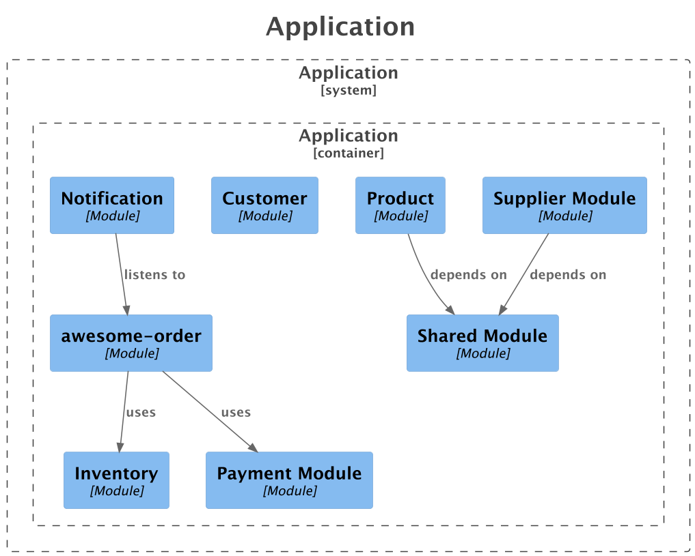

# Spring Modulith Demo

This project demonstrates **Spring Modulith** - a modular monolith architecture using Spring Boot. It showcases how to build a well-structured application with clear module boundaries, inter-module communication via Spring Events, and event externalization to Apache Kafka. Later on if needed, this one of module can be separated out into a µ-services.

## 🎯 Key Features

- **Package-based Module Separation**: Application is organized into distinct modules, including `order`, `inventory` and `notification`
- **Synchronous Stock Reservation**: Order calls the public Inventory API in the same database transaction, preventing overselling with atomic stock updates
- **Asynchronous Notifications**: A transactional module listener queues one persistent notification per order after commit; failed processing remains recoverable
- **Event-Driven Communication**: Modules communicate using Spring's `ApplicationEventPublisher` 
- **Kafka Event Externalization**: Internal events annotated with `@Externalized` are published to Kafka by Spring Modulith
- **Event Publication Tracking**: JDBC-based event publication registry automatically creates `event_publication` table to track event status
- **OAuth2/OIDC Authentication**: Secured with Keycloak for enterprise-grade authentication and authorization
- **Role-Based Access Control**: Fine-grained authorization using Keycloak realm and client roles
- **Modularity Verification**: Unit tests verify module structure and dependencies
- **Auto-generated Documentation**: PlantUML diagrams and module documentation generated from code

## 📦 Project Structure


```
spring-modulith-demo/
├── src/main/java/com/paxier/spring_modulith_demo/
│   ├── Application.java
│   ├── config/            # JPA and security configuration
│   ├── customer/          # Customer module (JPA)
│   │   ├── controller/    # CustomerController
│   │   ├── entity/        # CustomerEntity, AddressEntity, AddressType
│   │   ├── mapper/        # CustomerMapper
│   │   ├── model/         # Customer, Address
│   │   ├── service/       # CustomerService
│   │   ├── CustomerRepository.java
│   │   ├── AddressRepository.java
│   │   └── package-info.java
│   ├── order/             # Order module – public API: the event only
│   │   ├── OrderPlaceEvent.java # Externalized event for kafka
│   │   ├── package-info.java
│   │   └── internal/     # Entities, repository, service and REST controller
│   ├── payment/           # Payment module
│   ├── inventory/         # Public stock API
│   │   ├── InventoryService.java
│   │   ├── InventoryItem.java
│   │   └── internal/     # JDBC stock repository and REST controller
│   ├── notification/      # Public notification query API
│   │   ├── NotificationService.java
│   │   ├── Notification.java
│   │   └── internal/     # Async order listener, delivery repository and REST controller
│   ├── product/           # Product module (JPA)
│   ├── shared/            # Shared entity infrastructure
│   └── supplier/          # Supplier module (JPA)
└── src/test/java/
    ├── ModularityTests.java   # Module structure verification
    └── customer/
        ├── CustomerIntegrationTest.java
        ├── CustomerServiceTest.java
        └── CustomerControllerTest.java
```

## 🏗️ Architecture

### Module Dependencies Diagram



### Modules Overview

#### 1. Customer Module (JPA-based)
- **Technology**: Spring Data JPA with separate tables
- **Entities**: `CustomerEntity` (`customer.customer` table) and `AddressEntity` (`customer.address` table)
- **Relationship**: OneToMany from customer to addresses, with cascading and orphan removal
- **Endpoints**:
  - `POST /customers` - Create customer with address
  - `GET /customers` - Get all customers
  - `GET /customers/{id}` - Get customer by ID
- **Testing**: Integration and repository tests with Zonky Embedded PostgreSQL

#### 2. Order Module (Spring Data JPA)
- **Technology**: Spring Data JPA for orders and line items
- **Communication**: Publishes `OrderPlaceEvent` to Kafka
- **Event Tracking**: Spring Modulith uses JDBC for its `event_publication` table, independently of JPA entity persistence

#### 3. Product Module
- **Service Layer**: Business logic for products

#### 4. Inventory Module
- **API**: `InventoryService` exposes `getStock`, `addStock` and `reserve(items)` using `InventoryItem(productId, quantity)`.
- **Persistence**: Owns `inventory.stock`; other modules do not access this table directly.
- **Transactions**: `reserve` uses `Propagation.MANDATORY`, so it always joins the caller's transaction. Order, stock changes and event publications commit or roll back together.
- **Concurrency**: `UPDATE ... SET quantity = quantity - ? WHERE quantity >= ?` checks and decreases stock in one atomic statement, so concurrent orders cannot oversell.
- **Endpoints**: `GET /inventory/{productId}` returns available quantity (zero for an unstocked product); `POST /inventory/{productId}/stock` adds a positive quantity and requires the `admin` role.
- **Scope**: Kept intentionally simple: no reservation history, cancellation or idempotency. Products are referenced by ID only.

#### 5. Notification Module
- **Integration**: `@ApplicationModuleListener` consumes `OrderPlaceEvent` asynchronously after a successful commit, in its own transaction. Async processing is enabled on `Application`.
- **Persistence**: Owns `notification.delivery`; `(order_id, kind)` is the primary key, so retries cannot create a second order confirmation job.
- **Endpoint**: `GET /notifications/orders/{orderId}` returns a queued notification or HTTP 404 if it is not yet available.
- **Scope**: This demo queues jobs with status `PENDING`. It does **not** send email or run a delivery worker. The registry marks successful queueing, not successful external delivery.
- **Reliability**: Listener errors propagate to the event registry. Outstanding publications can be resubmitted; restart republishing is already enabled. External delivery would need its own worker, retry and idempotency strategy.

### Module Communication Flow

1. **Order Creation**: `OrderController` receives HTTP POST request
2. **Synchronous Reservation**: `OrderService` saves the order and calls `InventoryService.reserve`. Missing or insufficient stock raises HTTP 409 and rolls back the transaction.
3. **Internal Event**: `OrderService` publishes `OrderPlaceEvent` using `ApplicationEventPublisher`. The event contains immutable item snapshots rather than JPA entities, retaining the JSON fields `id`, `productId` and `quantity`.
4. **Commit**: The existing demo payment call remains inside the transaction. A thrown payment error rolls back the order, stock changes and event publications.
5. **Asynchronous Reactions**: After commit, Notification queues a delivery job. Existing Product handling and Kafka externalization remain in place.
6. **Event Tracking**: Spring Modulith JDBC records publications per transactional listener in `event_publication`. Notification can lag behind order creation and must be queried separately.

Inventory does not depend on Order. Order depends on Inventory's public API, and Notification depends on Order's public event. Both new modules keep repositories and controllers in internal packages. Flyway migrations create separate schemas in the same PostgreSQL database; schemas document ownership but are not access-control barriers when using one database user.

### Database Migrations (Flyway)

The whole database schema is managed by Flyway. Each module owns its migrations
in its own folder under `src/main/resources/db/migration`:

```
db/migration/
  customer/      V1_1__customer_schema.sql
  product/       V1_2__product_schema.sql
  supplier/      V1_3__supplier_schema.sql   (FK to product, so it runs after it)
  order/         V1_4__order_schema.sql
  inventory/     V1_5__inventory_schema.sql
  notification/  V1_6__notification_schema.sql
  modulith/      V1_7__event_publication.sql
```

Flyway scans the subfolders automatically, but version numbers are global:
every new migration needs a unique version across all modules.

Hibernate only validates the mapping (`ddl-auto: validate`). Never change an
applied migration; add a new migration with the next free version instead
(e.g. `order/V2_1__add_order_status.sql`).

### Event Publication Table

The `event_publication` table tracks listener processing. It is created by the
Flyway migration `modulith/V1_7__event_publication.sql` (Spring Modulith's own schema
initialization is disabled). Inspect the current demo's entries with:

```sql
SELECT id, event_type, listener_id, publication_date, completion_date, status
FROM event_publication
ORDER BY publication_date DESC;
```

This enables:
- **Reliability**: Failed events can be republished on restart
- **Observability**: Track which events were published successfully
- **Transactional Outbox Pattern**: Events are stored in the same transaction as business data

This is not an event-sourcing store or an exactly-once guarantee. A listener
may run again after a crash; Notification therefore deduplicates delivery jobs.

## 🚀 Getting Started

### Prerequisites

- Java 25
- Maven Wrapper (`./mvnw`)
- Docker & Docker Compose

### Running the Application

1. **Start Infrastructure** (PostgreSQL + Kafka + Keycloak):
   ```bash
   docker compose up -d
   ```

   This will start:
   - PostgreSQL on `localhost:5432`
   - Kafka on `localhost:9092`
   - Keycloak on `localhost:8180`

2. **Configure Keycloak** (First-time setup):
   
   Follow the detailed setup guide in [KEYCLOAK_SETUP.md](KEYCLOAK_SETUP.md) to:
   - Create the `spring-modulith` realm
   - Configure OAuth2 client
   - Create test users and roles
   - Get access tokens

   **Quick Setup**:
   - Access Keycloak Admin Console: http://localhost:8180 (admin/admin)
   - Create realm: `spring-modulith`
   - Create client: `spring-modulith-client`
   - Create user: `testuser` / `password`
   - Assign roles: `user`, `admin`

   The checked-in `application.yml` currently points to the `master` realm.
   If you create the `spring-modulith` realm as described here, update both
   `issuer-uri` and `jwk-set-uri` to match it before running the application.

3. **Run the Application**:
   ```bash
   ./mvnw spring-boot:run
   ```

   The application will:
   - Start on `http://localhost:8080`
   - Auto-create the `event_publication` table
   - Connect to Kafka at `localhost:9092`
   - Validate JWT tokens from Keycloak

4. **Get Access Token**:
   ```bash
   TOKEN=$(curl -X POST http://localhost:8180/realms/spring-modulith/protocol/openid-connect/token \
     -H "Content-Type: application/x-www-form-urlencoded" \
     -d "client_id=spring-modulith-client" \
     -d "client_secret=YOUR_CLIENT_SECRET" \
     -d "username=testuser" \
     -d "password=password" \
     -d "grant_type=password" | jq -r '.access_token')
   ```

5. **Create an Order** (Protected Endpoint):
   First add stock using a token with the `admin` role:
   ```bash
   curl -X POST http://localhost:8080/inventory/101/stock \
     -H "Authorization: Bearer $TOKEN" \
     -H "Content-Type: application/json" \
     -d '{"quantity":10}'
   ```

   Then place the order using an authenticated user's token. Stock is **not**
   seeded automatically: missing or insufficient stock returns HTTP 409.
   ```bash
   curl -X POST http://localhost:8080/orders \
     -H "Authorization: Bearer $TOKEN" \
     -H "Content-Type: application/json" \
     -d '{
       "lineItems": [
         {"productId": 101, "quantity": 2}
       ]
     }'
   ```

   Check remaining stock and the queued notification (replace `ORDER_ID` with
   the generated order ID, available from the order log or database):
   ```bash
   curl -H "Authorization: Bearer $TOKEN" http://localhost:8080/inventory/101
   curl -H "Authorization: Bearer $TOKEN" http://localhost:8080/notifications/orders/ORDER_ID
   ```
   Notification creation is asynchronous, so the second request may initially
   return 404. A successful response has `"status":"PENDING"`; no email is sent.

6. **Create a Customer with Addresses** (Requires the `admin` Role):
   ```bash
   curl -X POST http://localhost:8080/customers \
     -H "Authorization: Bearer $TOKEN" \
     -H "Content-Type: application/json" \
     -d '{
       "name": "John Doe",
       "addresses": [{
         "street": "123 Main Street",
         "city": "New York",
         "zipCode": "10001",
         "type": "HOME"
       }]
     }'
   ```
   
   This demonstrates **JPA's OneToMany relationship**: a customer can have multiple addresses linked through the `customer_id` foreign key.

7. **Get All Customers** (Protected Endpoint):
   ```bash
   curl -H "Authorization: Bearer $TOKEN" http://localhost:8080/customers
   ```

8. **Verify Kafka Message**:
   ```bash
   # Consume messages directly (no need to enter the container)
   docker exec -it spring-modulith-demo-kafka-1 kafka-console-consumer \
     --bootstrap-server localhost:9092 --topic order-created --from-beginning
   ```

   > The Confluent image ships the CLI tools without the `.sh` suffix
   > (`kafka-console-consumer`, not `kafka-console-consumer.sh`).
   > Drop `--from-beginning` to only read new messages, and press `Ctrl+C` to stop.

   You'll see JSON messages like:
   ```json
   {
     "orderId": 1,
     "lineItems": [
       {"id": 1, "productId": 101, "quantity": 2}
     ]
   }
   ```

## 🧪 Testing

### Modularity Tests

Run tests to verify module structure:

```bash
./mvnw test
```

The `ModularityTests` class:
- **Verifies module boundaries**: Ensures modules only access allowed dependencies
- **Generates documentation**: Creates PlantUML diagrams in `target/spring-modulith-docs/`
- **Validates structure**: Fails if modules violate architectural rules

### Inventory and Notification Workflow Tests

Run the architecture, Order regression, workflow and notification recovery tests
without starting Docker Compose or connecting to Kafka:

```bash
./mvnw \
  -Dspring.docker.compose.enabled=false \
  -Dspring.modulith.events.externalization.enabled=false \
  -Dtest=ModularityTests,OrderServiceTests,OrderControllerTests,OrderServiceIntegrationTest,OrderWorkflowIntegrationTest,NotificationRecoveryIntegrationTest \
  test
```

Integration tests use the existing Zonky embedded PostgreSQL dependency.
The workflow tests cover commit and rollback, insufficient stock, duplicate
product lines, concurrent reservations, replay-safe notification jobs, request
validation and admin-only stock additions. The recovery test deliberately
fails a notification listener and resubmits its persisted event publication.
The existing Order integration test's local transaction tests are retained.

### Generated Documentation

After running tests, check `target/spring-modulith-docs/`:
- `components.puml` - Overall architecture diagram
- `module-order.puml` - Order module diagram
- `module-customer.puml` - Customer module diagram
- `module-product.puml` - Product module diagram
- `module-inventory.puml` - Inventory module diagram
- `module-notification.puml` - Notification module diagram
- `all-docs.adoc` - Complete documentation

## ⚙️ Configuration

### application.yml

The following example assumes the `spring-modulith` realm from the setup guide.
The checked-in configuration currently uses `master`; both JWT URLs must match
the realm issuing your tokens.

```yaml
spring:
  modulith:
    events:
      republish-outstanding-events-on-restart: true  # Retry failed events
      jdbc:
        schema-initialization:
          enabled: false  # event_publication is created by Flyway
  kafka:
    bootstrap-servers: localhost:9092
  security:
    oauth2:
      resourceserver:
        jwt:
          issuer-uri: http://localhost:8180/realms/spring-modulith
          jwk-set-uri: http://localhost:8180/realms/spring-modulith/protocol/openid-connect/certs
```

### Public Endpoints

The following endpoints don't require authentication:
- `/actuator/**` - Actuator endpoints
- `/apidoc/**` - Swagger UI
- `/v3/api-docs/**` - OpenAPI documentation
- `/swagger-ui/**` - Swagger UI resources

All other endpoints require a valid JWT token from Keycloak.

## 🔐 Security & Authentication

This application uses **OAuth2/OIDC** with Keycloak for authentication and authorization.

### Authentication Flow

1. **User logs in** to Keycloak (or gets token programmatically)
2. **Keycloak issues JWT token** with user information and roles
3. **Client sends token** in `Authorization: Bearer <token>` header
4. **Spring validates token** against Keycloak's public keys
5. **Roles are extracted** from token claims (realm_access, resource_access)
6. **Access granted/denied** based on user's roles

### Role-Based Authorization

You can secure methods using `@PreAuthorize`:

```java
@PreAuthorize("hasRole('admin')")
public void deleteOrder(int orderId) {
    // Only admins can delete
}

@PreAuthorize("hasAnyRole('user', 'customer')")
public Order getOrder(int orderId) {
    // Users and customers can view
}
```

### Keycloak Setup

See [KEYCLOAK_SETUP.md](KEYCLOAK_SETUP.md) for detailed instructions on:
- Creating realm and client
- Managing users and roles
- Getting access tokens
- Testing with curl/Postman

## 📚 Spring Modulith Concepts

### 1. Module Definition
Each top-level package under the main package is a module:
- `com.paxier.spring_modulith_demo.customer` → Customer module
- `com.paxier.spring_modulith_demo.order` → Order module
- `com.paxier.spring_modulith_demo.product` → Product module
- `com.paxier.spring_modulith_demo.inventory` → Inventory module
- `com.paxier.spring_modulith_demo.notification` → Notification module

### 2. Module Communication
Modules use **public APIs** when an immediate transactional result is required
and **Spring Application Events** for decoupled reactions:
```java
// Publishing module
publisher.publishEvent(new OrderPlaceEvent(orderId, itemSnapshots));

// Subscribing module
@ApplicationModuleListener
void onOrderPlaced(OrderPlaceEvent event) {
    // Handle event
}
```

### 4. Event Publication Registry
The `event_publication` table tracks:
- **Pending events**: Not yet published to external systems
- **Completed events**: Successfully published
- **Failed events**: Can be republished on restart

## 🔍 Verification

### Modulith Observability

Spring Modulith provides Actuator endpoints to view the application module structure and metadata:

**View Module Structure**:
```bash
curl http://localhost:8080/actuator/modulith
```

This endpoint shows:
- Module boundaries and relationships
- Module dependencies
- Event listeners and publishers
- Externalized events configuration
- 
### Check Event Publication Table

```sql
SELECT * FROM event_publication;
```

### View Kafka Topics

```bash
docker exec -it spring-modulith-demo-kafka-1 kafka-topics \
  --list --bootstrap-server localhost:9092
```

### Monitor Kafka Messages

```bash
# Read all messages from the beginning
docker exec -it spring-modulith-demo-kafka-1 kafka-console-consumer \
  --bootstrap-server localhost:9092 \
  --topic order-created \
  --from-beginning

# Live-tail only new messages (Ctrl+C to stop)
docker exec -it spring-modulith-demo-kafka-1 kafka-console-consumer \
  --bootstrap-server localhost:9092 --topic order-created

# Include the key and headers (event metadata)
docker exec -it spring-modulith-demo-kafka-1 kafka-console-consumer \
  --bootstrap-server localhost:9092 --topic order-created --from-beginning \
  --property print.key=true --property print.headers=true
```

> **Note:** `spring-modulith-demo-kafka-1` is the container name created by
> `compose.yaml`. If yours differs, find it with `docker ps`.

## 🛠️ Technology Stack

- **Spring Boot 4.1.1**
- **Spring Modulith 2.1.1**
- **Spring Security 7.x** with OAuth2 Resource Server
- **Keycloak 23.0** for Authentication & Authorization (Docker Compose image)
- **Spring Data JPA** for domain persistence
- **Spring Modulith JDBC Event Publication Registry**
- **Spring Kafka**
- **PostgreSQL**
- **Apache Kafka** via the **Confluent Platform 7.6.1** Docker images
- **Java 25**

## 📖 References

- [Spring Modulith Documentation](https://spring.io/projects/spring-modulith)
- [Spring Modulith Reference Guide](https://docs.spring.io/spring-modulith/reference/)
- [Modular Monolith Pattern](https://www.kamilgrzybek.com/blog/posts/modular-monolith-primer)

## 📝 License

This is a demo project for learning purposes.
